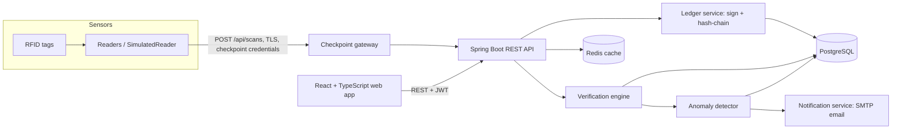

# Architecture

## High-level view



## NIST SP 800-183 mapping

| SP 800-183 primitive | TraceGuard component |
|----------------------|----------------------|
| Sensor | RFID tags and readers at checkpoints (simulated) |
| Aggregator | Checkpoint gateway service that batches and forwards scans |
| Communication channel | Secured REST/TLS between readers, gateway and server |
| External utility | Ledger database, key store, notification service |
| Decision trigger | Verification engine and anomaly detector (verdict and alert) |

## Backend modules (Spring Boot, package `com.traceguard`)

| Package | Responsibility |
|---------|----------------|
| `auth` | Login, JWT issuing and validation, RBAC rules |
| `org` | Organizations, users, checkpoints |
| `catalog` | Products, batches, tags, QR codes |
| `reader` | `Reader` interface, `SimulatedReader`, optional `SerialReader` |
| `ledger` | Event creation, SHA-256 chaining, ECDSA signing, append-only repository |
| `crypto` | Key generation and storage, hashing and signature helpers |
| `policy` | Route policies (approved checkpoint order, time limits) |
| `verify` | Verification engine and verdict |
| `anomaly` | Rule-based detectors (see below) |
| `alert` | Alerts, notification center, email |
| `analytics` | Aggregated queries for dashboards |
| `report` | PDF/CSV audit exports |
| `audit` | User action log |

## Ledger design

Each event stores `prev_hash` (the `hash` of the tag's previous event, or 64 zeros for the first) and its own `hash`:

```
hash = SHA-256( tag_id | checkpoint_id | event_type | occurred_at | seq | nonce | prev_hash )
signature = ECDSA_sign( checkpoint_private_key, hash )
```

- Events are chained per tag. `(tag_id, seq)` and `(tag_id, nonce)` are unique.
- The table accepts inserts only; database triggers reject UPDATE and DELETE.
- The API has no update or delete endpoint for events.

## Verification flow

1. Load all events for the tag in sequence order.
2. For each event: recompute the hash, check `prev_hash` link, verify the signature with the checkpoint public key.
3. Compare the checkpoint order with the route policy for the product type; check time limits between checkpoints.
4. Run the anomaly detectors.
5. Combine into a verdict: any broken hash or signature gives `COUNTERFEIT`; anomalies or route/timing violations give `SUSPECT`; otherwise `AUTHENTIC`. Each finding is a machine-readable reason code.

## Anomaly detectors (rule-based, Java)

| Code | Rule |
|------|------|
| DUPLICATE_PRESENCE | Same tag scanned at two different locations within an overlapping window |
| IMPOSSIBLE_TRAVEL | Distance between checkpoints divided by elapsed time exceeds a speed limit |
| UNREGISTERED_TAG | Scan for a tag ID that was never issued |
| UNAUTHORIZED_LOCATION | Scan at a checkpoint not in the product's route policy |
| SCAN_BURST | More than N scans of one tag in a short window |

An optional statistical model (z-score or Isolation Forest via a Python microservice) can be added later behind a REST scoring endpoint.

## Deployment (Phase 5)

Docker Compose: Nginx (TLS) in front of the Spring Boot container and the React static build, with PostgreSQL and Redis. Target: AWS, GCP or Heroku.
