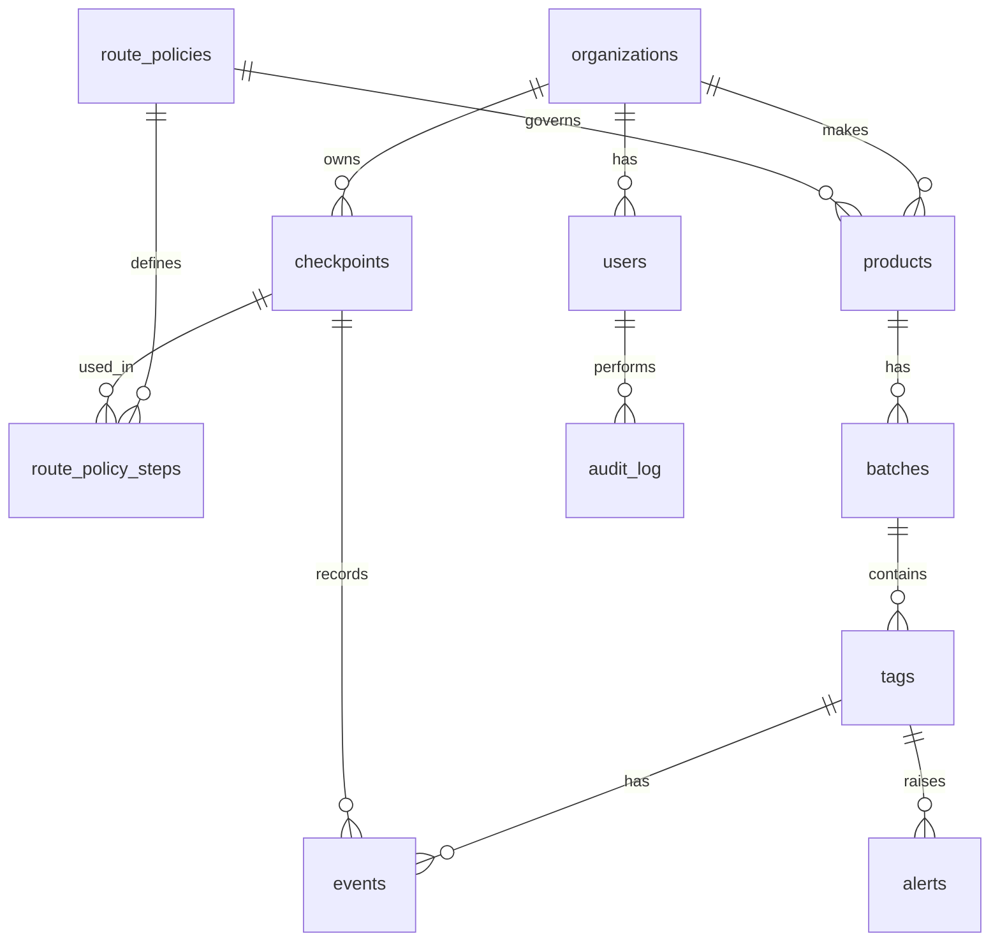

# Database schema

The full DDL is in [database/schema.sql](../database/schema.sql). Docker Compose loads it automatically on first start.

## Design decisions

- **Per-tag chain.** Each tag has its own hash chain (`seq`, `prev_hash`, `hash`), which keeps verification fast (NFR-1) and writes independent (NFR-2).
- **Append-only enforced twice.** The API exposes no update/delete, and a database trigger rejects UPDATE and DELETE on `events` (FR-5).
- **Replay protection.** `UNIQUE (tag_id, nonce)` rejects a resubmitted scan.
- **Keys.** Checkpoint public keys live in `checkpoints.public_key`; private keys stay in a key store outside the database.
- **Recall.** `batches.recalled` flags every product in a batch at once (FR-10).

## Open questions for the team

- Use Flyway or Liquibase for migrations?
- Store route-policy time limits per step only, or also a total limit (currently both).
